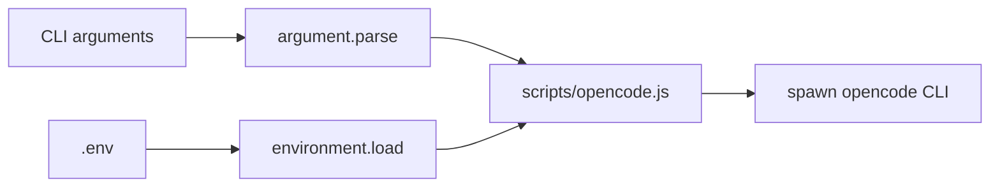

# Template

[](https://github.com/yuriusuonly/template/actions/workflows/ci.yaml)

An agentic template repository using OpenCode + Bun. It provides launchers for OpenCode, the skills CLI, and Bun itself, plus a `system/` toolkit of small wrappers that keep the launchers consistent about environment loading, argv pass-through, and plain-data results.

## Table of contents

- [Requirements](#requirements)
- [Setup](#setup)
- [`.env`](#env)
- [Usage](#usage)
- [Workspace root](#workspace-root)
- [OpenCode configuration](#opencode-configuration)

## Requirements

| Requirement | Value |
| --- | --- |
| Bun | >=1.4.5 (verified 1.4.5); the declared runtime |
| OS | linux |
| Runtime APIs | Standard `node:*` modules, including `node:util.parseEnv` and top-level await |
| `@opencode/cli` | ^2.4.1, installed locally as a dev dependency |
| `skills` | ^1.9.0 |

## Setup

Install dependencies once before running anything:

```sh
bun install
```

Then create `.env` in the project root with the values described below. It is gitignored, so it stays out of commits; every value is a quoted string. The launchers treat a missing `.env` as an empty environment, so tests also run in CI without one.

## `.env`

Keys and what they describe:

| Key | Description |
| --- | --- |
| `NAME` | Project name used as the project's identity. |
| `DESCRIPTION` | Short summary of the project. |
| `VERSION` | Project version string. |
| `ORGANIZATION` | Organization or scope the project belongs to. |
| `AUTHOR` | Author name for the project. |
| `EMAIL` | Contact email for the author. |
| `WEBSITE` | Author's webpage URL. |
| `PORT` | Port the local application listens on. |
| `PORT_PROXY` | Port used by the proxy in front of the application. |
| `OPENCODE_API_KEY` | Token OpenCode uses to authenticate. |
| `GITHUB_TOKEN` | Personal access token for the GitHub MCP server, substituted into `opencode.json`. |
| `GITHUB_REPOSITORY` | GitHub remote URL configured as the `origin` git remote. |

The values are parsed with `node:util.parseEnv`, which strips the surrounding quotes. Never commit real token values.

## Usage

Run OpenCode through the package script. Arguments after `--` are passed through to the OpenCode CLI:

```sh
bun run opencode -- mcp list
bun run opencode -- --standalone --log-level debug
```

Each launcher passes arguments through in order, loads the `.env` values, changes into the workspace root, times the child with `debug()`, and reports failures. A parallel launcher runs the skills CLI:

```sh
bun run skill -- list
bun run skill -- add github/github-mcp-server --skill '*' --agent opencode --yes --full-depth
```

A third launcher runs Bun commands with the same environment and working directory:

```sh
bun run bun -- --version
```

Official GitHub skills come from `github/github-mcp-server` (GitHub workflow skills) and `github/awesome-copilot` (Actions and CI skills such as `github-actions-hardening`, `github-actions-efficiency`, and `diagnose-ci-gate`). They are installed into `.agents/skills/`, with `skills-lock.json` recording the installed versions. Pass one `--skill <name>` flag per skill; the CLI does not split comma-separated values.



## Workspace root

```text
./
├── .agents/              # installed agent skills
├── .env                  # gitignored metadata and tokens
├── .github/              # CI workflow
├── .gitignore            # excludes .env and node_modules/
├── AGENTS.md             # session guidance for OpenCode
├── bun.lock              # pinned dependency tree
├── bunfig.toml           # Bun test configuration
├── CONTRIBUTING.md       # formatting, docs, and commit conventions
├── README.md             # this overview
├── node_modules/         # installed dependencies (generated)
├── opencode.json         # OpenCode MCP, compaction, and instructions
├── package.json          # ESM manifest and dev dependencies
├── scripts/              # executable entrypoints: opencode, skill, bun, gh, git
├── skills-lock.json      # installed skill versions
├── system/               # reusable utility wrappers
└── test/                 # unit tests for the utilities
```

`scripts/` and `system/` hold the implementation. Their internal layout and conventions are covered by the source files and `CONTRIBUTING.md` rather than repeated here.

## OpenCode configuration

`opencode.json` registers the hosted GitHub MCP server using `GITHUB_TOKEN` through `Bearer {env:GITHUB_TOKEN}` with `oauth: false`, disables automatic compaction so context is not silently summarized, and loads `CONTRIBUTING.md` as additional instructions.

Launch OpenCode through the package script so the token reaches the process, and refresh the background service with `bun run opencode -- service restart` after changing tokens.
